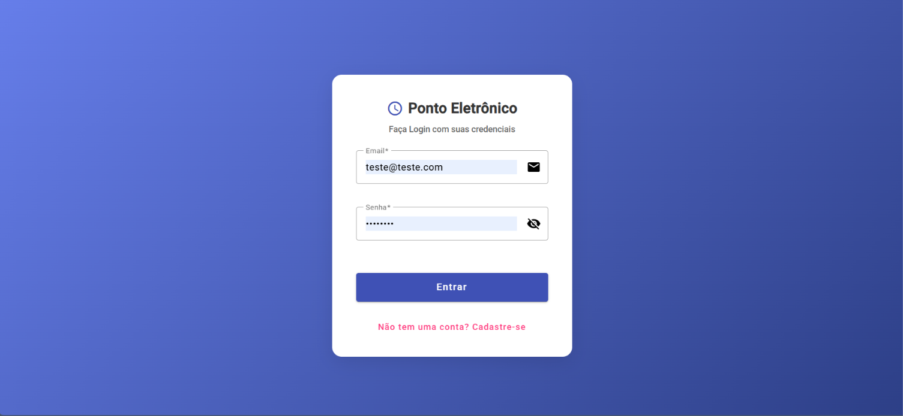
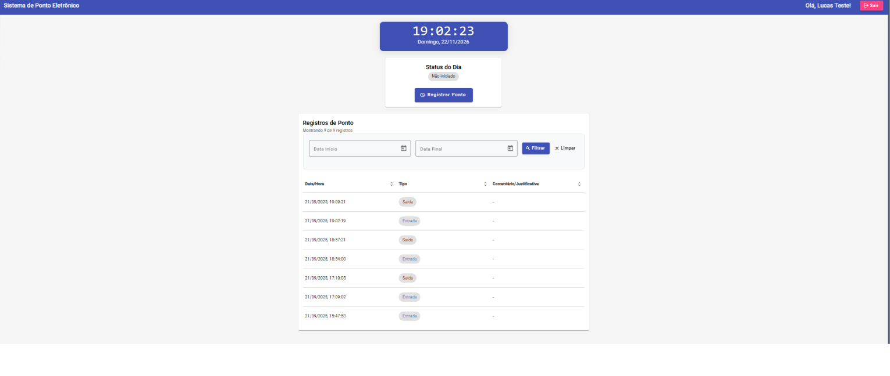

[🇺🇸 English](README.md) | 🇧🇷 Português

# Sistema de Ponto Eletrônico

Sistema completo de controle de ponto eletrônico desenvolvido com **Angular 15** e **.NET 6**, criado como desafio técnico. Permite que funcionários registrem e consultem suas marcações de forma segura e intuitiva.

## Screenshots

| Login                       | Dashboard e histórico                                              |
| --------------------------- | ------------------------------------------------------------------ |
|  |  |

## Índice

- [Funcionalidades](#funcionalidades)
- [Arquitetura](#arquitetura)
- [Estrutura do Projeto](#estrutura-do-projeto)
- [Configuração e Instalação](#configuração-e-instalação)
- [API Endpoints](#api-endpoints)
- [Banco de Dados](#banco-de-dados)
- [Segurança](#segurança)
- [Tecnologias Utilizadas](#tecnologias-utilizadas)
- [Configuração para Produção](#configuração-para-produção)
- [Melhorias Possíveis](#melhorias-possíveis)
- [Licença](#licença)

## Funcionalidades

**Autenticação e segurança**
- Login seguro com JWT (JSON Web Tokens)
- Registro de novos usuários
- Controle de sessão e renovação automática de tokens
- Logout seguro
- Proteção de rotas com guards

**Registro de ponto**
- Marcação de entrada e de saída, com data e hora automáticas
- Descrição opcional para cada marcação (o modelo de dados também prevê os tipos de início e fim de intervalo)

**Visualização e consulta**
- Dashboard com o status do dia em tempo real e relógio digital
- Histórico completo de marcações
- Filtros por período (data início/fim), paginação e ordenação por colunas (data/hora, tipo, descrição)

## Arquitetura

**Backend (.NET 6)**
- API REST com ASP.NET Core 6
- Autenticação via ASP.NET Identity e JWT Bearer
- SQL Server com Entity Framework Core (migrations)
- Validação com FluentValidation
- Documentação interativa com Swagger/OpenAPI

**Frontend (Angular 15)**
- Angular 15.2 com Angular Material
- Tratamento do JWT por interceptors HTTP
- Formulários reativos com validação
- Layout responsivo para desktop e mobile

## Estrutura do Projeto

```
PontoEletronico/
├── PontoEletronico.Api/          # Backend (.NET 6)
│   ├── Controllers/              # Endpoints da API
│   ├── Services/                 # Lógica de negócio
│   ├── Models/                   # Modelos de dados
│   ├── DTOs/                     # Data Transfer Objects
│   ├── Data/                     # Contexto do banco
│   ├── Validators/               # Validações FluentValidation
│   ├── Middleware/               # Middlewares customizados
│   └── Migrations/               # Migrações do banco
├── PontoEletronico.App/          # Frontend (Angular)
│   ├── src/app/components/       # Componentes da aplicação
│   ├── src/app/services/         # Serviços Angular
│   ├── src/app/models/           # Interfaces TypeScript
│   ├── src/app/interceptors/     # Interceptors HTTP
│   ├── src/app/guards/           # Route Guards
│   └── src/assets/               # Recursos estáticos
└── README.md
```

## Configuração e Instalação

### Pré-requisitos

- [.NET 6 SDK](https://dotnet.microsoft.com/download/dotnet/6.0)
- [Node.js 16+](https://nodejs.org/)
- [Angular CLI 15+](https://angular.io/cli)
- [SQL Server LocalDB](https://docs.microsoft.com/sql/database-engine/configure-windows/sql-server-express-localdb) ou SQL Server

Você precisará de **duas janelas de terminal**: uma para o backend e outra para o frontend. Os dois precisam estar rodando ao mesmo tempo.

### 1. Clone do repositório

```bash
git clone https://github.com/CodeDLucas/PontoEletronico.git
cd PontoEletronico
```

### 2. Backend

Edite o arquivo `PontoEletronico.Api/appsettings.json`:

```json
{
  "ConnectionStrings": {
    "DefaultConnection": "Server=(localdb)\\mssqllocaldb;Database=PontoEletronicoDb;Trusted_Connection=true;MultipleActiveResultSets=true"
  },
  "JwtSettings": {
    "SecretKey": "SUA_CHAVE_SECRETA_AQUI_MINIMO_32_CARACTERES",
    "Issuer": "PontoEletronicoAPI",
    "Audience": "PontoEletronicoApp",
    "ExpirationMinutes": 60
  }
}
```

Crie o banco e execute a API:

```bash
cd PontoEletronico.Api
dotnet ef database update
dotnet run
```

A API fica disponível em `https://localhost:7059` e o Swagger em `https://localhost:7059/swagger`.

### 3. Frontend

```bash
cd PontoEletronico.App
npm install
ng serve
```

Confira se `src/environments/environment.ts` aponta para a API:

```typescript
export const environment = {
  production: false,
  apiUrl: 'https://localhost:7059'
};
```

A aplicação fica disponível em `http://localhost:4200`.

## API Endpoints

**Autenticação**
- `POST /api/auth/login` - Realizar login
- `POST /api/auth/register` - Registrar novo usuário
- `POST /api/auth/logout` - Realizar logout
- `POST /api/auth/refresh` - Renovar token
- `GET /api/auth/verify` - Verificar token

**Registros de ponto**
- `POST /api/timerecord` - Criar nova marcação
- `GET /api/timerecord` - Listar marcações (com filtros)
- `GET /api/timerecord/{id}` - Obter marcação específica
- `GET /api/timerecord/today` - Marcações do dia atual
- `GET /api/timerecord/summary` - Resumo agrupado por dia
- `DELETE /api/timerecord/{id}` - Remover marcação

**Usuários**
- `GET /api/user/profile` - Obter perfil do usuário
- `PUT /api/user/profile` - Atualizar perfil
- `POST /api/user/change-password` - Alterar senha

## Banco de Dados

**ApplicationUser**
- `Id` (string), `FullName` (string), `Email` (string, único)
- `EmployeeCode` (string, opcional)
- `CreatedAt` (DateTime), `IsActive` (bool)

**TimeRecord**
- `Id` (int), `UserId` (string, FK para ApplicationUser)
- `Timestamp` (DateTime)
- `Type` (enum: ClockIn / ClockOut / BreakStart / BreakEnd)
- `Description` (string, opcional), `CreatedAt` (DateTime)

## Segurança

- **HTTPS:** redirecionamento forçado
- **JWT:** tokens com expiração configurável
- **CORS:** restrito às origens permitidas
- **Validação:** no cliente e no servidor
- **SQL Injection:** prevenção via consultas parametrizadas (Entity Framework)
- **Autorização:** controle de acesso por usuário autenticado
- **Política de senha:** mínimo de 6 caracteres, com letra minúscula, maiúscula e número; bloqueio após 5 tentativas incorretas

## Tecnologias Utilizadas

**Backend:** .NET 6, ASP.NET Core Web API, Entity Framework Core 6.0.33, ASP.NET Identity, FluentValidation 11.3.0, JWT Bearer Authentication, SQL Server, Swagger/OpenAPI

**Frontend:** Angular 15.2.0, Angular Material 15.2.9, TypeScript 4.9.4, RxJS 7.8.0, SCSS

## Configuração para Produção

**Backend**
1. Crie o `appsettings.Production.json` com a connection string de produção, uma chave JWT segura e única e as configurações de logging.
2. Configure o CORS para o domínio de produção.

**Frontend**
1. Atualize o `environment.prod.ts` com a URL da API de produção.
2. Gere o build com `ng build --configuration=production` e sirva os arquivos de `dist/`.

## Melhorias Possíveis

- Testes automatizados (unitários e de integração)
- Pipeline de CI
- Atualização para as versões LTS atuais do .NET e do Angular
- Containerização com Docker

## Licença

Este projeto está licenciado sob a MIT License. Veja o arquivo [LICENSE.txt](LICENSE.txt) para detalhes.
